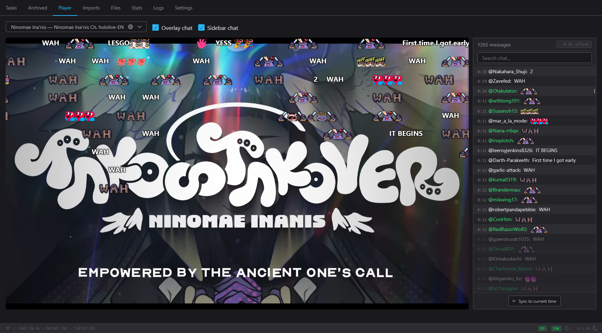

# Player

The web dashboard's **Player** tab plays your finished recordings in the
browser, with the recorded chat replayed in time with the video — as a
scrolling sidebar, as Niconico-style comments flying across the picture, or
both. It also remembers where you stopped, marks recordings watched, and shows
and edits chapters.

The player is part of the [web dashboard](web-dashboard.md) only; the terminal
UI has no player.

## Opening a recording

Two ways:

- Open the **Player** tab (or press ++3++) and pick a recording from the
  **Video** dropdown.
- Click **Play** in a finished job's details dialog. The dashboard switches to
  the Player tab with that job loaded.

The dropdown lists every `Finished` job that has an output file, from both the
Tasks and Archived tabs, newest first, as "*Title* — *Channel*". Recordings
with no chat capture are marked **(no chat)**. The list updates while the tab
is open: a recording that finishes appears, a deleted one disappears. Clear
the dropdown (its **✕**) to stop playback.

The video plays straight from the Moombox server, so it works from any
device that can reach the dashboard.

!!! note "Audio your browser cannot play"
    Moombox keeps the best audio track YouTube offers, which is sometimes a
    5.1 E-AC-3 track that most Chrome and Firefox builds cannot decode. When
    the browser cannot play an archive's audio, a notice under the video says
    so, for example *"This archive's audio (E-AC-3, 5.1) can't play in this
    browser; the file is fine. Open it in VLC or mpv."*

### Split recordings

A recording that was saved as several parts (for example when a Twitch
stream changed quality mid-broadcast) plays as one continuous timeline. A
coloured bar under the video shows each part, labelled with its quality; hover
for its length, click to jump to its start. Seeking, the chat, chapters and
the resume position all work across the parts.

## Chat replay

When the job has a chat capture, two checkboxes in the header control how it
is shown:

| Checkbox | Default | Shows |
|---|---|---|
| **Overlay chat** | On | Comments flying across the video. |
| **Sidebar chat** | Off | A scrolling chat panel beside the video. |

Both choices are remembered in this browser. If your operating system asks
for reduced motion and you have never set **Overlay chat** yourself, it
starts off. For a recording without chat, neither the overlay nor the
sidebar is shown.

Chat is recorded when [Download chat](../configuration/downloader.md#downloaderdownload_chat)
is on. A message's place on the timeline comes from the capture; Moombox
corrects for the gap between when the chat capture and the video started, and
merges the per-part chat files of a split recording onto one timeline.

### The sidebar

The sidebar's header shows the message count, for example **12,345 messages ·
210 pre-show · 18 after end**.

- Messages already reached by playback are shown normally; the ones still
  ahead are dimmed. The sidebar follows playback automatically.
- Messages posted before the stream started (the waiting room) are separated
  by a divider: **Waiting room — 210 messages before the stream**.
- Messages posted after the end of the recording get a **Recording ended —
  18 messages after it** divider, and become readable once playback reaches
  the end.
- **Click a message's timestamp** to jump the video to 3 seconds before that
  message, so you see it arrive.
- **Search chat** filters the list to messages whose author or text contains
  the search (it also matches Super Chat amounts, membership messages and
  Twitch sub/raid notices). Clear the search to return to the live position.

**Auto-scroll** stops while your mouse pointer is over the sidebar and when
you scroll it yourself. Click **Sync to current time** at the bottom to jump
back to the current message and resume following.

What the sidebar shows besides plain messages:

- **Super Chats** as coloured cards, by the same colour tiers YouTube uses
  (grey and blue through red), with the amount in the header.
- **Membership** messages as green cards.
- **Twitch** subscriptions, resubscriptions, gift subs and raids as notice
  lines; cheers with a coloured bits chip; announcements highlighted in their
  colour.
- **Emotes**: YouTube emoji and channel emotes, and on Twitch the native
  emotes plus 7TV, BTTV and FFZ emotes captured with the chat.
- **deleted** — a message that was removed during the stream is struck
  through with a *deleted* tag (hover the tag for how it was removed, when
  the capture recorded it).
- **edited** — a message that was replaced shows the new text with an
  *edited* tag; hover the tag for the original.

### Chat offset

If the chat runs ahead of or behind the video, type a number of seconds into
the offset box in the sidebar header (placeholder **-0.0s offset**):

- A **positive** number shows each message that many seconds **earlier**.
- A **negative** number shows each message **later**.

Decimals are allowed. The change applies immediately to both the sidebar and
the overlay, and is saved for this job when you press ++enter++ or leave the
box, so it applies on every device. The **✕** beside the box resets it to 0.

## Flying comments (overlay)

With **Overlay chat** on, each message crosses the picture from right to left,
Niconico style:

- Every comment takes **4 seconds** to cross, so longer comments move faster.
- A comment starts moving **1 second before** its timestamp, so it is fully on
  screen when its moment arrives.
- Comments are spread over rows that fill the actual picture (not the black
  bars of a letterboxed or pillarboxed video), and a row only takes a new
  comment once the previous one cannot be caught up with.
- When chat is busier than the screen can hold, a comment that cannot get a
  row within about 2 seconds is skipped, and a small **+N not shown** pill
  appears for a few seconds. Use the sidebar to read everything.
- The overlay pauses with the video, follows the playback speed, clears when
  you seek, and restarts from the new position.
- Deleted messages never fly; an edited one flies with its new text.
- The comments are drawn over the video, not into it: they are not saved in
  the file and are not visible in other players.

## Keyboard controls

These keys work while the Player tab is open, as long as you are not typing in
a field and no dialog is open. A reminder appears over the video when you hover
over it.

| Key | Action |
|---|---|
| ++space++ | Play / pause |
| ++left++ / ++right++ | Seek back / forward 5 seconds |
| ++shift+left++ / ++shift+right++ | Seek back / forward 30 seconds |
| ++up++ / ++down++ | Volume up / down |
| ++f++ | Toggle fullscreen (the overlay stays visible) |
| ++m++ | Toggle mute |
| ++c++ | Toggle **Overlay chat** |
| ++s++ | Toggle **Sidebar chat** |

The browser's own video controls (seek bar, speed, picture-in-picture where
offered) work as usual. The dashboard's ++1++–++8++ tab keys still work here;
++a++ (add video) and ++f++ (filter) do not, because ++f++ is fullscreen.

## Resume position and watched marks

While you watch, Moombox saves your position: every 10 seconds of playback,
whenever you pause, and when you close or leave the page. The next time you
open the recording — in any browser — the player offers:

**Resume where you left off?** — **Resume from 1:23:45** or **Start from
beginning**. ++esc++ starts from the beginning.

A recording is marked **watched** automatically when playback gets within the
last 30 seconds (for anything longer than a minute) or past 95 % of its length.
Marking a recording watched — automatically or by hand — clears its saved
position.

Where you see it:

- On the job's thumbnail in Tasks and Archived: a filled eye for watched, an
  outlined eye for "started, not finished".
- In the job details dialog: a **Watched** or **Paused at 1:23:45** pill next
  to the status.
- In the terminal UI, a watched job's row carries a dim `•`.

To change it by hand:

=== "Web dashboard"

    - In a finished job's details: **Mark Watched** or **Mark Unwatched**.
    - For several jobs: select them and use **Mark Watched** / **Mark
      Unwatched** in the batch bar.

    **Mark Unwatched** also appears for a job that is only partly watched; it
    clears the saved position.

=== "Terminal UI"

    `A W` (**Toggle Watched**) on a finished job. It works on a selection of
    several jobs too.

Only `Finished` jobs can be marked watched.

## Chapters

When a recording has chapters, the player shows them two ways:

- A **strip of markers** directly under the video, one per chapter start.
  Hover over or keyboard-focus a marker for its name and time; click it to
  jump there.
- A collapsible **Chapters (N)** list with each chapter's start time and
  title. Click a row to jump to it. Whether the list is open or closed is
  remembered in this browser (it starts closed).

The chapter you are in is highlighted in both.

The **Import chapters** button under the video pastes a viewer's timestamp
comment in as the recording's chapters. It is shown only for a complete
`Finished` recording. See [Chapters](chapters.md).

## Troubleshooting

"Video failed to load"
:   The file could not be read from the server — it may have been moved or
    deleted outside Moombox. For a split recording the message is "Video
    failed to load — segment may be missing". Check the job's **Filename**
    and **Parts** in its details.

"Failed to load chat replay" / "Some chat replay failed to load"
:   The chat file exists but could not be read; the video still plays. For a
    split recording the toast names the parts that failed.

The video plays but there is no sound
:   Look for the audio notice under the video (see above). Open the file in
    VLC or mpv, or download a different audio format next time with the
    **Advanced** options in **Add video**.

"Could not open the recording: …"
:   The job could not be fetched from the server (it may have just been
    deleted). The dropdown goes back to what was playing.
