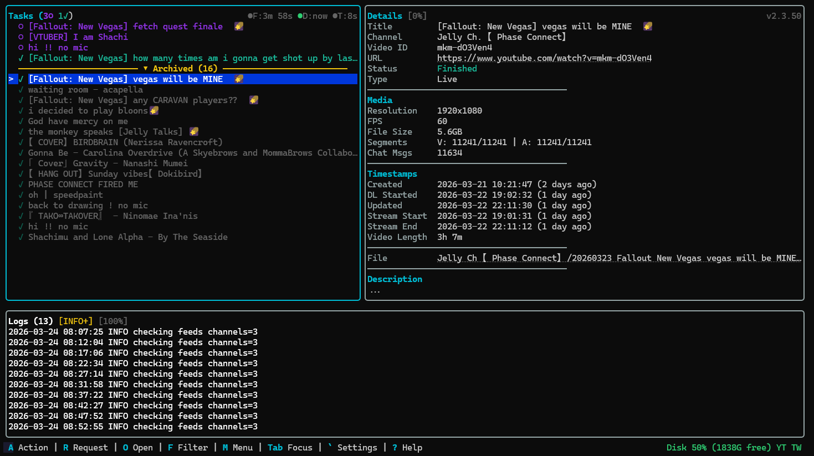

# Terminal UI

When you start Moombox in a terminal, it opens a full-screen terminal UI (TUI).
The TUI runs in the same process as the downloader, the monitors and the
[web dashboard](web-dashboard.md). Both UIs show the same jobs and the same
settings, and an action taken in one appears in the other right away. You can
manage Moombox entirely from either one, and you can use both at once.

Every key and chord is listed in the [keyboard shortcuts reference](../reference/shortcuts.md).
This page explains what each part of the screen shows and how the actions behave.

## When the TUI runs

The TUI starts only when standard input and standard output are both a
terminal. Moombox runs **headless** (web dashboard only) when:

- you pass `-no-tui` or `-headless` on the command line (see the [command-line reference](../reference/cli.md));
- the environment variable `MOOMBOX_NO_TUI` is `1`, `true` or `yes` (case-insensitive);
- there is no terminal, for example when Moombox runs as a service or its output is piped.

In headless mode the log says `Running in headless mode (web-only)` (or
`Non-interactive terminal detected, running in headless mode`), and you
manage everything from the [web dashboard](web-dashboard.md).

!!! note "Docker"
    The Docker image sets `MOOMBOX_NO_TUI=1`, so a container never shows the
    TUI, even with `docker run -it`. Use the web dashboard. See
    [Docker](../getting-started/docker.md).

!!! warning "Quitting the TUI stops Moombox"
    The TUI is not a separate client. Quitting it (`Q Q` or ++ctrl+c++) shuts
    down the whole program, including running downloads and the web
    dashboard. To keep Moombox running without a terminal, run it headless.

On a first run (no config file yet), the TUI opens the setup wizard before
anything else; see [First run](../getting-started/first-run.md). If FFmpeg is
not found at startup, an **FFmpeg check** screen offers to install it
(Chocolatey or Winget on Windows; install instructions on Linux), lets you
enter a custom FFmpeg path, skip for now, or quit.

The terminal window's title shows `Moombox`, followed by `— N active` and
`— N upcoming` when there are active or upcoming jobs.

## Screen layout

From top to bottom the screen has:

1. **Banners** (only when needed), full width:
    - A yellow **restart required** banner: `⚠ Restart required — saved config differs from running process. Press R P P to restart Moombox, or restart it yourself.` It appears after you save a setting that only takes effect on restart, and stays until the process restarts.
    - A red **security** banner when the dashboard is reachable from outside your machine with no password set (`network_access` is an external value and no dashboard password exists). It tells you to set a password from Settings → Network or lower [`network.network_access`](../configuration/network.md#networknetwork_access).
2. **Tasks** panel (top left) and **Details** panel (top right).
3. **Logs** panel (full width).
4. The **status bar** (one row).
5. The **feedback line**, which appears over the bottom of the Logs panel for a few seconds after an action.

The TUI needs a terminal of at least 60 columns by 20 rows. In a smaller
window it shows only `Terminal too small` with the required size until you
enlarge it.

One panel has focus at a time; its border is highlighted. Press ++tab++ to move
focus forward (Tasks → Details → Logs) and ++shift+tab++ to move back, or click
a panel. The focused panel gets more room: with Tasks or Details focused the
top row takes about 70% of the height, and with Logs focused the Logs panel
takes about 75%. Tasks is 45% wide when focused, 35% when Details is focused,
and half the width otherwise.

## Tasks panel

The Tasks panel lists every job. Its header reads `Tasks (…)` with a count per
status, using the status icons, for jobs that are not archived. When a filter
is active the query is shown in yellow brackets, for example
`[status:active]`. On the right are the monitor countdowns and, when the list
is longer than the panel, the visible range (`[1-20/57]`).

The countdowns are `F:` (YouTube feed check), `D:` (DecAPI check) and `T:`
(Twitch check), each with a dot. A grey dot means the check is waiting; a
green dot with `…` means a check is running now. Each timer only appears when
that monitor has a next check scheduled.

### Rows

Each row shows, from left to right:

| Part | Meaning |
|---|---|
| `>` | The cursor (the selected row also gets a blue background). |
| `✓` (green) | The job is ticked for a batch action (see [Batch selection](#batch-selection)). |
| Status icon | Coloured by status (table below). |
| Progress | Percentage for `Downloading` and `Muxing` jobs; a wait or hold tag otherwise (below). |
| `[TW]` | A Twitch job. |
| `[CLIP]` | A Twitch clip job. |
| `•` (dim) | A `Finished` job you have marked watched (`A W`). |
| Title | In the status colour; falls back to the video ID when there is no title. A long title on the selected row scrolls. |

| Icon | Status | Colour |
|---|---|---|
| `▼` | `Live`, `Downloading` | green |
| `⎈` | `Muxing` | yellow |
| `○` | `Upcoming` | purple |
| `⋯` | `Queued` | grey |
| `✓` | `Finished` | teal |
| `✗` | `Error` | red |
| `⊘` | `Cancelled` | dark grey |
| `⏣` | `COOKIES?` (shown as **Auth Required** in Details) | magenta |

On terminals that support curly underlines, the icon is underlined in red for
`Error`, magenta for `COOKIES?`, and orange for a `Finished` job whose recording
has an incomplete tail (it can still be resumed).

Tags that can appear in the progress slot:

| Tag | Meaning |
|---|---|
| `⋯ wait` | The download is waiting (for example, between retries) rather than making progress. |
| `⏸ offline` | A `Queued` job held because Moombox is offline. |
| `⏸ disk` | A `Queued` job held because the output disk reached the critical threshold. See [`disk.disk_critical_percent`](../configuration/disk-memory-connectivity.md#diskdisk_critical_percent). |
| `⏸ rate limit` | A `Queued` YouTube job held for an hour after a YouTube rate-limit. |
| `⟳ 2/3` | A `Queued` job waiting to retry (attempt 2 of 3). |
| `⟳ mux` | An `Error` job that Moombox will mux by itself once the Twitch monitor confirms the broadcast is over. |
| `⟳ retry` | An `Error` job that Moombox will retry by itself when the Twitch channel is live again. |

See [Jobs](jobs.md) for what each status and hold means.

### Order and the archive

Active rows are sorted by status — `Error`, `COOKIES?`, `Downloading`,
`Muxing`, `Live`, `Upcoming`, `Queued`, then `Cancelled` and `Finished` —
alphabetically by title within a status (case and accents ignored), except
`Cancelled` and `Finished`, which are newest first.

`Finished` jobs older than [`monitors.hide_finished_age_days`](../configuration/monitors.md#monitorshide_finished_age_days)
move below a yellow divider, `▸ Archived (N)`. Select the divider and press
++enter++ (or click it) to expand it (`▾`) or collapse it. Archived rows are
dimmed and sorted newest first. The archive is re-checked once a minute, so a
job moves under the divider as it ages.

### Filtering

There are two ways to filter the list. Both edit the same query.

- **`F`** cycles the status filter: all → `status:active` → `status:issues`
  → `status:finished` → all. Active is `Downloading`, `Live`, `Upcoming`,
  `Muxing` and `Queued`; issues is `Error`, `Cancelled` and `COOKIES?`;
  finished is `Finished`. `F` replaces only the status term and leaves the
  rest of your query alone.
- **`/`** opens a query box below the header. The list filters as you type.
  ++enter++ closes the box and keeps the query; ++esc++ in the box closes it
  and clears the query. With the box closed, ++esc++ clears an applied query.

The query language is the same as the dashboard's filter:

| Term | Matches |
|---|---|
| `word` | Title, channel name or video ID contains the text (case-insensitive). |
| `"quoted phrase"` | The phrase as one term. |
| `status:live` | That exact status. `status:active`, `status:issues` (or `status:errors`) and `status:finished` select the groups above. |
| `channel:"Name"` | Channel name equals the value (case-insensitive). |
| `platform:youtube`, `platform:twitch` | That platform. |
| `type:clip` | Twitch clip jobs. |
| `-term` | Negates a term, for example `-status:finished`. |
| `a\|b` | Either term. |

Terms separated by spaces must all match. Changing the filter moves the
cursor to the top. A ticked job that the filter hides is removed from the batch
selection, so a batch action only acts on rows you can see.

### Batch selection

With the Tasks panel focused, ++space++ ticks or unticks the row under the
cursor, and ++ctrl+a++ ticks every row shown. The status bar shows
`N selected`. While any rows are ticked, the
batch-capable chords act on the ticked rows instead of the cursor row:

`A R` (Resume), `A I` (Reinitialize), `A X` (Cancel), `A D` (Delete) and `A W` (Toggle Watched).

A batch acts only on the ticked jobs that qualify. The confirm prompt counts
those, for example `Press D to confirm delete 3 jobs (3s)`, and the result
line says how many were done and how many the server refused, with the first
reason. `A W` marks all the eligible jobs watched unless every one already is,
in which case it unmarks them. After a batch the selection is cleared.
++esc++ clears the selection (and cancels any armed chord). Rows hidden in a
collapsed archive are dropped from the selection.

Other chords ignore the selection and act on the cursor row.

## Details panel

The Details panel shows the selected job. Its header shows `Details`, the
scroll position when the content is longer than the panel, and on the right
the running version (`v1.2.3`), or a green `v1.2.3 ⬆ Update!` when an update is
available.

Depending on the job, it shows:

- **Title, Channel, Video ID** (**Stream ID** for Twitch jobs), **Stream URL**, **Status** (coloured; `COOKIES?` reads **Auth Required**), **Type** (VOD or Live), start-time and gap-fill notes, and for Twitch the **Platform**, **Category** and **Quality**.
- **Advanced Options** when the job was added with a chosen video or audio format or a time range.
- **Progress**: progress text, **Queue** (why a `Queued` job is waiting), **Speed**, **ETA**, and chat capture state.
- **Media**: resolution, FPS, file size.
- **Timestamps**: Created, DL Started, Updated, Stream Start or Scheduled, Stream End, Video Length, and a live **Duration**, **Job Time** or **Starts In**.
- **Error** with the error text, or **Not a Member** for a job parked because the account lacks a channel membership.
- **Automatic**, in cyan, when Moombox will mux or retry the job by itself. Don't reinitialize such a job unless you mean to cancel that.
- **Filename** (a clickable `file://` link in terminals that support links).
- **Set-aside Recordings (N)**: recordings Moombox kept aside after it could not resume a stream mid-way, with time, size and whether a resume sidecar exists, plus the chat capture state. Recover them with `A S`.
- **Kept for a Mux Gap (N)**: staged recordings kept because a mux could not carry them whole, with the reason.
- **Description**, segment counts, chat message count and gaps.

With Details focused, `F` hides or shows the description; the header shows
`[filtered]` while it is hidden. Scroll with the arrow keys, ++page-up++ /
++page-down++, ++ctrl+u++ / ++ctrl+d++ or the mouse wheel.

## Logs panel

The Logs panel shows Moombox's own log as it is written. It keeps the last
1,000 lines. Long lines wrap at word boundaries. The header shows `Logs (N)`
and, when they apply, the active search with its match count, the level filter
and `[PAUSED]`.

- **`F`** (Logs focused) cycles the minimum level: all → `INFO+` → `WARN+` → `ERROR+` → all. Lines without a level are always shown.
- **`/`** opens a search box. Type text and press ++enter++; matches are highlighted (case-insensitive) and the view jumps to the first match at or below the top of the view. `n` and `N` move to the next and previous match, wrapping around. ++esc++ while typing cancels the box; ++esc++ afterwards clears the search.
- **`c`** clears the log view (the lines, and any search). The level filter stays. This does not touch the log file.
- Scrolling up pauses auto-scroll; the panel shows `↓ Auto-scroll paused (End to resume)`. ++end++ resumes following new lines. Moving focus away from Logs also resumes it.

For one job's log, use `O L` (below).

## Status bar

The left half lists the chord prefixes: ``A Action | R Request | O Open | E Extras | F Filter | M Menu | Tab Focus | ` Settings | ? Help``.
Until you press a prefix, `M`, `?` or `` ` `` for the first time in a session,
it shows a hint instead: `Press ? for help · M for menu · A for actions`.

The right half shows alerts and figures:

| Indicator | Meaning |
|---|---|
| `OFFLINE` (red) | Moombox has lost internet connectivity. |
| `SIDECAR DOWN` (red) | The BotGuard sidecar is not running: PO tokens cannot be minted and signature-protected YouTube formats cannot be resolved. |
| `N selected` (yellow) | Rows ticked for a batch action. |
| `Backfill <channel>: <tab> p<pages>` (green) | A feed-history backfill scan in progress. |
| `BF: retry` (dim) | A backfill scan ended incomplete and will be retried on the next sweep. |
| `Disk 45% (120G free)` | Output disk usage. Green normally, orange at the warning threshold, red at the critical threshold. `holding` (or `⏸`) means backlog admission is held by the disk gate. |
| `Active: N` (green) | Jobs `Downloading`, `Live` or `Muxing`. |
| `YT`, `TW` | Cookie status per platform (below). |

The cookie indicators appear only for the platforms enabled in
[`cookies.active_platforms`](../configuration/cookies.md#cookiesactive_platforms)
(Settings → Cookies → **YouTube cookies** / **Twitch cookies**):

| Indicator | Meaning | What to do |
|---|---|---|
| green `YT` / `TW` | Cookies are configured and authenticate. | Nothing. |
| orange `YT~` / `TW~` (`YT~ pages flicker, retry after 14:05` on a wide bar) | Flickering: the cookies authenticate, but a page came back signed out in the last 24 hours. | Nothing; Moombox retries by itself at the time shown. `R C` spells it out at any width. |
| yellow `YT` | No YouTube cookies configured. | Optional; see [Cookies](cookies.md). |
| dim `TW` | No Twitch cookies configured (or no check yet). | Optional. |
| orange `YT: Unknown` | The last check could not reach a conclusion (network error, unexpected answer). | Usually nothing; it is re-checked. |
| red `YT` | The cookies were rejected, or a job on that platform is parked in `COOKIES?`. | Export fresh cookies (`E I`) or log in again (`E L`). |
| red `YT: Re-login` | The session expired; sign in again. The full-width bar adds `(E L)`. | Press `E L`. It opens on the flagged platform. |
| magenta `YT: cookies.txt unreadable` | The cookie file exists but cannot be read (permissions, a wrong mount). | Fix the file's permissions or path. |

On a narrow terminal the bar drops detail step by step: labels shorten
(`D:45% 120G`, `▶3`, `3 sel`, `BF:videos p4`), chord names go, and finally only
alerts remain (`OFF`, `POT`, `YT!`, `YT?`, `YT~`, `D:96%`). The alerts are the last
thing removed.

## Feedback line

Each action writes a one-line message just above the status bar. Most
messages stay for 3 seconds and are cut to one row. A few long ones (cookie
check results, the archive import's outcome) wrap onto several rows and stay
3 seconds per row. `Invalid Chord: …` stays for 1 second. The colour tells you
the outcome:

- **yellow**: a chord prompt, such as `Action: A Add | Z Import | … (3s)` or `Press X to confirm cancel "…" (3s)`, or a warning, such as `No cancellable jobs in selection`;
- **red**: an error or refusal, including `Invalid Chord: A Q` and anything that says `failed`. A single-job cancel (`Cancelled: <title>`) is also shown in red;
- **grey**: a deletion (`Deleted: …`);
- **green**: success, and most other notes.

When a chord does not apply to the selected job, the line names the reason,
for example `Mux Job: no muxable jobs in selection`, and the chord resets.

## Chords

Most actions are two-key chords: a prefix key, then an action key, within 3
seconds. Letters are case-insensitive.

| Prefix | Group | What it holds |
|---|---|---|
| `A` | Action | Job actions, adding and importing videos, trims, orphans, tokens, chapters. |
| `R` | Request | Ask the running program for something: re-scans, cookie checks, updates, monitor checks, restart. |
| `O` | Open | Open folders, stream pages, the dashboard, the GitHub page, a job's log; copy a URL. |
| `E` | Extras | yt-dlp plugin, cookie login, cookie file import, statistics. |
| `Q` | Quit | `Q Q` quits. |

Pressing a prefix lists the chords available right now on the feedback line,
for example `Open: F Folder | S Stream | W Web | C Copy URL | L Log | G GitHub (3s)`.
Chords that need a job only appear when the selected job qualifies (or, for
batch chords, when rows are ticked). A key that is not a valid chord shows
`Invalid Chord: …` and resets.

### Confirm chords

Destructive chords need a third press of the same key within 3 seconds: `A I I`,
`A M M`, `A S S`, `A X X`, `A D D`, `A U U` and `R P P`. The second key shows a
prompt such as `Press D to confirm delete "Stream title" (3s)`. Any other key
cancels with `Invalid Chord`. The confirm acts on the job the prompt named, even
if the cursor moves in the meantime.

`A I` (Reinitialize) names what the reset deletes and any automatic action it
cancels, for example
`Press I to confirm reinit: cancels the pending automatic mux, and deletes 2 recorded parts (1.2GB) and 40 staged files (850.0MB) — "Title" (3s)`.
The dashboard shows the same summary before its Reinitialize.

### What each action chord does

| Chord | Action | Available for |
|---|---|---|
| `A A` | **Add Video**: opens the add dialog. | Always. |
| `A Z` | **Import Archive**: import a `.zip` holding one recording and its `<name>.chat.json`. | Always. |
| `A R` | **Resume Job**: continue a download from what is already staged. Batch-capable. | YouTube jobs in `Error`, `Cancelled` or `COOKIES?`, or `Finished` with an incomplete tail, whose staging still has files. |
| `A I I` | **Reinitialize Job**: reset the job to start again from scratch. Batch-capable. | `Error`, `Cancelled`, `COOKIES?`. |
| `A M M` | **Mux Job**: build the output file from what is staged. | `Error` or `Cancelled` with staged segments; `Finished` with an unmuxed part left in staging. |
| `A S S` | **Recover Set-aside Recordings**: mux each set-aside recording into its own file beside the archive, carry a kept chat capture beside the first, then clear staging if nothing unmuxed is left. | Jobs that are not active (`Upcoming`, `Live`, `Downloading`, `Muxing`) and have set-aside recordings. |
| `A X X` | **Cancel Job**. Batch-capable. | `Downloading`, `Live`, `Upcoming`, `Queued`, `Muxing`, `COOKIES?`. |
| `A D D` | **Delete Job**. Batch-capable. | `Finished`, `Error`, `Cancelled`, `COOKIES?`. Cancel an active job first. |
| `A W` | **Toggle Watched**: adds or removes the dim `•`. Batch-capable. | `Finished`. |
| `A T` | **Trim Video**: cut a clip from the archive. | `Finished` jobs with an output file. One trim runs at a time. |
| `A O` | **Browse Orphaned Items**. | Always. |
| `A K` | **Manage Client Tokens**. | Always. |
| `A C` | **Import Chapters**: paste a timestamp comment as the job's chapters. | Complete `Finished` jobs with an archive. |
| `A U U` | **Restore Original Chapters**: bring back the chapters the first import replaced. | Jobs whose chapters were imported. |

`A M`, `A S` and the recovery and reset actions share one per-job lock on the
job's staging, so two of them cannot run on the same job at once; the second is
refused with a message. See [Jobs](jobs.md) for when to use Resume, Mux and
Reinitialize, and [Chapters](chapters.md) for the chapter import.

### Request, Open and Extras chords

| Chord | Action |
|---|---|
| `R B` | **Re-scan Feed History**: queue a full-catalog backfill re-scan of every configured YouTube channel. Progress shows in the status bar. |
| `R C` | **Recheck Cookies**: re-validate the cookies on disk and report each platform's verdict. |
| `R F` | **Refresh Cookies from Browser**: refresh the cookies with the automated browser, or import them from the browser profile. Which one runs depends on [`cookies.acquisition`](../configuration/cookies.md#cookiesacquisition), on whether the browser may be launched ([`cookies.auto_enabled`](../configuration/cookies.md#cookiesauto_enabled)) and on what is installed; the result line names the one that ran. `R F` is offered even when `cookies.auto_enabled` is off. |
| `R V` | **Check for Updates**: reports `Already up to date` or `Update available: vX — R N for notes, R U to install`. |
| `R M` | **Check Monitors Now**: run every monitor's check immediately. |
| `R N` | **View Release Notes**: the pending update's notes when one is available, otherwise the running version's notes fetched from GitHub. |
| `R U` | **Apply Update**: only listed when an update is available. With downloads active it first warns that the restart interrupts them; press `R U` again within 5 seconds to go ahead. |
| `R S` | **Verify Signature**: check the running binary's signature and release manifest. |
| `R P P` | **Restart Program**. |
| `O F` | **Open Folder**: the job's output folder, or its staging folder while it is active. |
| `O S` | **Open Stream Page** in a browser. |
| `O C` | **Copy Stream URL (best effort)** to the clipboard (see below). |
| `O W` | **Open Web UI**: `http://localhost:<port>` (`https` when HTTPS is on). |
| `O L` | **Open Job Log**: the selected job's own log lines. |
| `O G` | **Open GitHub Page**. |
| `E Y` | **yt-dlp Plugin** status and install. |
| `E L` | **Cookie Login**: sign in through a browser. |
| `E I` | **Import Cookie File**: import a Netscape `cookies.txt`. |
| `E T` | **Statistics**. |

!!! note "Opening things on a remote or headless machine"
    `O F`, `O S`, `O W` and `O G` open the folder or page on the machine that
    runs Moombox (with `xdg-open` on Linux). Over SSH, or on a server without
    a desktop, nothing opens where you are sitting. Use `O C` to copy the URL
    instead.

`O C` always sends the URL through the terminal's clipboard escape sequence
(OSC 52), which reaches your local clipboard even over SSH if your terminal
supports it (tmux needs `set-clipboard on`). The line then says
`Sent to terminal clipboard (OSC 52): <url>`. On a local Windows console (not
Windows Terminal, not SSH) Moombox also runs `clip.exe`, and when that
succeeds the line changes to `Copied: <url>`.

## Overlays

Several chords open a full-screen overlay. While an overlay is open it takes
every key, except ++ctrl+c++, which always quits.

### Action menu (`M`)

`M` opens the **Action Menu**: every action grouped under Action, Request,
Open, Extras, Filter and Other, with its chord. Move with ++up++ / ++down++
(++page-up++ / ++page-down++ / ++home++ / ++end++ on long lists) and press
++enter++. Clicking or scrolling moves the selection but never runs an action.

- An action that needs a job opens a job picker listing only the jobs it
  applies to. Press ++enter++ to choose a job, then ++enter++ again to
  confirm (the footer shows what will happen, including the reinitialize
  summary). ++esc++ goes back.
- An action with nothing to act on is shown with its reason, such as
  `no jobs to resume`.
- Confirm-only actions such as Restart Program ask `Confirm: Restart Program?`
  (++enter++ / ++esc++).

`M` or ++esc++ closes the menu. The menu is the easiest way to discover chords,
and to act on a job without moving the cursor to it.

### Settings (`` ` ``)

The backtick key opens **Settings**, with the sections Network, Paths, Logs,
Monitors, Downloader, Cookies, Disk, Updates, BotGuard Sidecar, Twitch,
Memory, Channels and Integrations. Each field shows a short help text. The
[configuration reference](../configuration/index.md) documents every setting;
not every key is in the TUI, and some are only in the dashboard or
`config.toml`.

- ++up++ / ++down++ move between fields; type to edit a text or number field.
- ++left++ / ++right++ flip a toggle, cycle a choice, or step through presets (for example the resolution presets on **Max resolution**).
- ++shift+left++ / ++shift+right++ switch section; ++tab++ goes to the next section.
- ++shift+down++ jumps to the **Save & Return** / **Return** buttons; ++left++ / ++right++ pick one and ++enter++ activates it. ++up++ goes back to the fields.
- ++esc++ closes. With unsaved changes it asks `Save changes? [Y]es / [N]o / [Esc] Cancel`.
- On the Network section, from a toggle or choice row, `` ` `` sets or changes the dashboard password and `~` removes it.
- On the Paths section's **FFmpeg path** row, ++ctrl+o++ opens the FFmpeg check to install FFmpeg.
- **Channels**: `A` adds, ++enter++ edits, `D` removes a channel. Removing asks whether to keep the channel's jobs (++enter++) or also delete its pending ones (`P`, offered only when it has pending jobs); any other key cancels. The removal, and the deletion of pending jobs, happen when you save.
- **Integrations** (notification webhooks): `A` adds, ++enter++ edits, `D` deletes, `T` sends a test. In the editor, ++space++ toggles options and events, and `m` toggles the mention for an event.

If a saved change needs a restart, a **Restart Required** box offers
++enter++ to restart now or ++esc++ to close; if you close, the yellow banner
stays until you restart (`R P P`).

### Help (`?`)

`?` opens **Help**: the chord list built from the same source as the menu (so
it only lists chords available in this process), confirm chords shown in full
(`A X X`), and the quick keys, navigation and mouse keys. Scroll with the
arrows, ++page-up++ / ++page-down++ or ++ctrl+u++ / ++ctrl+d++; `?` or ++esc++
closes.

### Add Video (`A A`)

Enter a YouTube URL or video ID, a Twitch VOD (`v` + digits or a VOD URL), a
Twitch clip URL, a Twitch channel, or a Twitch channel's video list or
collection URL (which queues one VOD job per video). A channel's clips listing
is refused.

++tab++ toggles **Advanced Options**, which apply to YouTube only (a Twitch
entry is submitted straight away): after ++enter++ Moombox fetches
the available formats and you choose a video format (`A` auto/best, `N` none
for audio only, `1`–`9` or the arrows and ++enter++), an audio format the same
way, an optional start and end time (`HH:MM:SS`, `MM:SS` or seconds; ++tab++
switches field), and confirm with ++enter++. ++esc++ goes back a step.

### Import Archive (`A Z`)

Opens a file browser in the `import` folder under Moombox's working directory
(created if missing). Pick a `.zip` (++up++ / ++down++, ++right++ or ++enter++
to open or select, ++left++ or ++backspace++ to go up), then optionally
override the title and channel (++tab++ switches field) and press ++enter++ to
import.

### Trim Video (`A T`)

Enter a start and end time (++tab++ switches field, ++enter++ continues), check
the confirmation, and press ++enter++ to create the trim. The end must be after
the start, within the video's length, and at least 1 second later. While it
encodes, ++esc++ closes the dialog and the encode carries on in the background.
`M` switches to delete mode, which lists the job's existing trims; ++enter++
twice deletes the selected one.

### Orphaned items (`A O`)

Lists files and folders in the staging and output folders that no job owns,
and processing-history entries with no job. A history entry stops the monitor from
re-discovering that video; removing it lets the video be picked up again.
`D` twice (within 3 seconds) deletes the selected item, `A` twice deletes every
item in the current group, `R` refreshes. See [Storage](storage.md).

### Client tokens (`A K`)

**Connected Clients** lists the client tokens that keep a browser logged in to
the dashboard after its session ends (their lifetime is
[`network.client_token_ttl_days`](../configuration/network.md#networkclient_token_ttl_days)).
`D` twice (within 3 seconds) revokes the selected token, so that browser must
log in again; `R` refreshes. See [Security](../reference/security.md).

### Import Chapters (`A C`)

Paste a timestamp comment (for example one copied from YouTube). The dialog
previews the chapters against the current ones and fills in an offset
automatically; ++tab++ switches between the paste and the offset so you can
correct it. ++ctrl+s++ asks `Save N chapters, replacing the current M?` — `y`
or ++enter++ saves, any other key goes back. See [Chapters](chapters.md).

### Job log (`O L`)

Shows the selected job's own log lines (the same per-job log as the
dashboard's job dialog), refreshed every second. It works like the Logs panel:
arrows, ++page-up++ / ++page-down++, ++ctrl+u++ / ++ctrl+d++ and the mouse wheel
scroll; `/` searches with `n` / `N`; ++end++ follows new lines. ++esc++ clears a
search first, then closes; `Q` closes at once.

### Release notes (`R N`)

Shows release notes in a scrollable box (arrows, ++page-up++ / ++page-down++).
For a pending update the footer offers `U` to apply it and `S` to skip that
version; for the running version's notes only scrolling and closing (++esc++ or
`Q`) are offered. If the pending release changes while the notes are open,
`U` and `S` are withdrawn. See [Updating](../getting-started/updating.md).

### Cookie Login (`E L`)

Opens the setup wizard's cookie step on its own, with **YouTube**, **Twitch**
and **Close**. It preselects the platform the status bar flags for re-login.
Choose a platform and press ++enter++: Moombox opens a browser window. Sign in,
then press ++enter++ to extract the cookies. You have 5 minutes; the countdown
turns yellow in the last 10 seconds. ++esc++ cancels the sign-in. If time runs
out, `R` tries again and `S` skips. A finished platform gets a green `✓`.

This needs a supported browser on the machine running Moombox and a display
for it, so it is not useful on a headless server; use `E I` there. See
[Cookies](cookies.md).

### Import Cookie File (`E I`)

Type the path to a Netscape-format `cookies.txt` (quotes and a leading `~` are
accepted) and press ++enter++. Moombox imports it, then verifies each platform.
A platform whose cookies stop authenticating after the import keeps its
previous cookies (the import is rolled back for it). The result shows one line
per platform, such as `YouTube: imported (authenticates)`. ++esc++ while the
import runs closes the box; the import continues and its result appears on the
feedback line. The file's contents are never shown or logged, only its path.

### yt-dlp Plugin (`E Y`)

Shows whether Moombox's yt-dlp plugin is installed, the plugin folder,
Moombox's port and HTTPS state, and — if installed — the port the plugin points
at, with a mismatch warning when they differ. `I` installs or reinstalls the
plugin, `R` refreshes, ++esc++ or `Q` closes. See [yt-dlp plugin](ytdlp-plugin.md).

### Statistics (`E T`)

The same figures as the dashboard's Stats tab: a disk bar with used, total and
free space; total recorded size, total jobs, YouTube and Twitch storage, and
size by status (Finished, Error, Cancelled); streams archived, total recording
time, chat messages, active downloads, muxing, YouTube and Twitch job counts,
and uptime. It refreshes every minute; `R` refreshes now, ++esc++ or `Q` closes.
See [Statistics](statistics.md).

## Mouse

- Click a panel to focus it. Click a task row to select it; click the archive divider to expand or collapse it.
- The wheel scrolls the panel under the pointer, three rows a notch (in Tasks it moves the cursor).
- In the action menu, clicks and the wheel move the selection only. Settings can be clicked. Other overlays ignore the mouse, except the job log, which scrolls.

## Tips

- If a chord seems to do nothing, read the feedback line: it says why (`no finished jobs in selection`, `Invalid Chord`).
- Use `M` to act on any job without moving the cursor, and to see which actions are available.
- After changing a restart-required setting, `R P P` restarts Moombox from the TUI.
- The TUI and dashboard can be used at the same time; a job you cancel in the dashboard updates in the TUI immediately.
