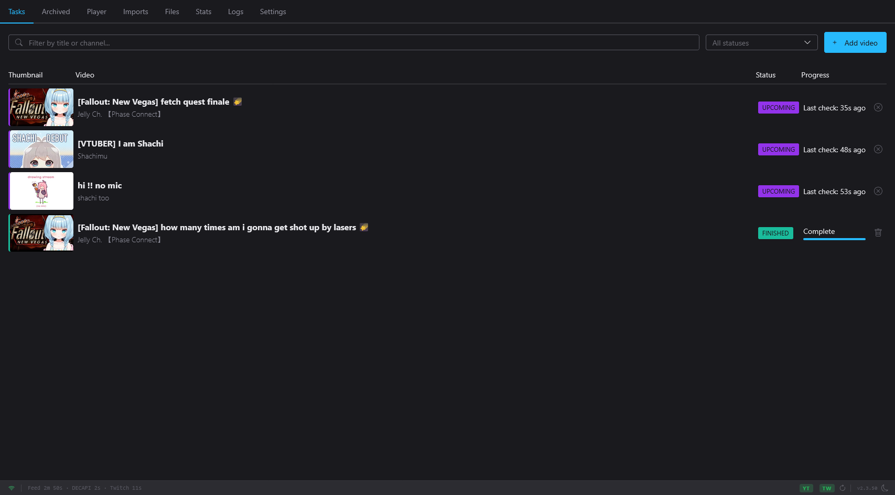

# Web dashboard

The web dashboard is Moombox's main graphical interface. It runs inside the
Moombox process and is served on the port you chose at first run (see
[Network settings](../configuration/network.md)); open it in any modern
browser. It covers the day-to-day work of the [terminal UI](terminal-ui.md),
plus the built-in [player](player.md), the archive importer and the trimmer.

!!! note "The browser needs to reach cdn.jsdelivr.net"
    The dashboard and the login page load their UI components and light and
    dark themes (the Shoelace library) from `cdn.jsdelivr.net`. Moombox does
    not serve them itself. A browser that cannot reach that host, for example
    on an offline LAN or an air-gapped or filtered network, gets a dashboard
    that is unstyled or does not work. Moombox keeps recording either way, and
    the [terminal UI](terminal-ui.md) needs no internet access. See
    [Security](../reference/security.md).



The page is one screen with eight tabs along the top and a status bar along
the bottom. It updates live over a WebSocket connection: job progress, new
jobs, log lines, disk readings and cookie status arrive without a reload.

| # | Tab | What it is for |
|---|---|---|
| 1 | **Tasks** | Every job that is waiting, running, failed, or recently finished. |
| 2 | **Archived** | Finished jobs older than the archive age. |
| 3 | **Player** | Watch a finished recording with its chat replay. See [Player](player.md). |
| 4 | **Imports** | Upload a `.zip` of an existing recording into your library. |
| 5 | **Orphaned** | Files and history entries that no job owns any more. |
| 6 | **Stats** | Storage and activity figures. See [Statistics](statistics.md). |
| 7 | **Logs** | The live application log. |
| 8 | **Settings** | Every setting, grouped into sections. See [Configuration](../configuration/index.md). |

Press ++1++ to ++8++ to jump straight to a tab.

## Signing in

The dashboard asks for a password only when **both** of these are true:

- [Network access](../configuration/network.md#networknetwork_access) allows
  connections from outside your machine and LAN (external access), and
- a dashboard password is set.

Then every page shows a login screen ("Enter your password to continue")
until you sign in. Sign-in attempts are limited to 5 per minute, and failed
attempts are logged with the client's address.

Once you are signed in, a **Log out** icon appears in the status bar. If your
session expires while the page is open, the connection badge changes to
**Session expired** and the page reloads to the login screen on its next
request.

!!! danger "Passwordless external access"
    If `config.toml` allows external access but no password is set (the
    dashboard and the TUI both refuse to save this combination, so it can
    only come from a hand-edited file), a red banner stays at the top of
    every page: *"External access is enabled without a dashboard password —
    anyone who can reach this port has full control."* Set a password in
    **Settings → Network → Password**, or lower **Network Access**. See
    [Security](../reference/security.md).

## The Tasks tab

The Tasks tab lists every job that has not yet been moved to the Archived
tab. Each row shows:

Thumbnail
:   The stream's thumbnail (Moombox's saved copy once it has one, otherwise
    the platform's). A Twitch channel that has not gone live yet shows the
    channel's avatar instead. Two small overlays can appear on a finished
    job's thumbnail:

    - an **eye** — filled when the job is marked watched, outlined when you
      stopped part-way through in the player (see [Player](player.md));
    - a **warning triangle** — "Recording is missing its tail — Resume to
      fetch it": the archive finished but its last segments are missing.

    The checkbox in the corner selects the row for [batch
    actions](#selecting-several-jobs).

Video
:   The title and channel name. A **TW** tag marks a Twitch job, and a
    **CLIP** tag marks a Twitch clip.

Status
:   A coloured badge with the job's status. The dashboard shows `COOKIES?` as
    **Auth Required**; everything else uses the status name (`Queued`,
    `Upcoming`, `Live`, `Downloading`, `Muxing`, `Finished`, `Error`,
    `Cancelled`). See [Jobs](jobs.md) for what each status means.

Progress
:   One line that depends on the status, plus a progress bar when a
    percentage is known. Hover over it for a fuller tooltip.

    | Status | What the progress line says |
    |---|---|
    | `Queued` | **Waiting in queue...**, or why the backlog scheduler is holding it: **Held: offline**, **Held: disk full**, **Held: YouTube rate limit until HH:MM**, or **Retry n of m at HH:MM**. |
    | `Upcoming` | A wait line naming what the job is waiting for (a download slot, a rate limit, the network), **Awaiting processing** (a VOD handed to processing), **Last check: 3 minutes ago** (a broadcast being waited for; updates every second), or **Waiting for stream...** |
    | `Live`, `Downloading` | The download counter, for example `(V: 1234/1300 A: 1234/1300 C: 5678)` — video and audio segments, then chat messages. The tooltip spells it out ("Video: 1234/1300 segments, Audio: …, Chat: 5,678 messages"). A YouTube VOD shows a percentage (`V:95.3% C: 456`); a Twitch capture shows a segment count (`Seq: 123 C: 456`). |
    | `Muxing` | **Muxing...** or the muxer's own progress. |
    | `Finished` | **Complete** (or **Finished** when there is no output file). |
    | `Error` | The error, cut to 50 characters. Click it to expand the full text, click again to collapse. A Twitch job that will recover on its own is prefixed with **⟳ Auto-retry pending** or **⟳ Auto-mux pending** (hover for the condition). |
    | `COOKIES?` (Auth Required) | **Needs cookie refresh**, or **Not a member — needs member account** for members-only content. |

Actions
:   On a desktop browser, small icon buttons appear when you hover over (or
    keyboard-focus) a row:

    | Button | Shown for | Does |
    |---|---|---|
    | **Cancel** | `Downloading`, `Live`, `Upcoming`, `Queued`, `Muxing`, `COOKIES?` | Asks "Are you sure you want to cancel this job?", then stops it. |
    | **Resume** | YouTube jobs in `Error`, `Cancelled` or `COOKIES?` whose staging folder still exists | Continues the download from the segments already on disk. No confirmation. |
    | **Reinitialize** | `Error`, `Cancelled`, `COOKIES?` (as a row icon only when Resume is not offered; the phone **⋮** menu lists both) | Starts the job again from scratch, after a confirmation. |
    | **Delete** | `Finished`, `Error`, `Cancelled`, `COOKIES?` | Asks "Are you sure you want to delete this job?", then removes the job. |

    Click anywhere else on the row to open the [job details
    dialog](#job-details).

The list is sorted by status group, most urgent first: `Error`, Auth Required
(`COOKIES?`), `Downloading`, `Muxing`, `Live`, `Upcoming`, `Queued`,
`Cancelled`, `Finished`. Inside the first seven groups rows are alphabetical
by title; `Cancelled` and `Finished` rows are newest first (by last update).

!!! warning "Reinitialize deletes recorded data"
    Before the confirmation appears, the dashboard asks the server exactly
    what a reset would remove, and the dialog names it — for example
    *"Reinitialize "…" and download it again from the start? This deletes 2
    recorded parts (3.1GB) and 41 staged files (812.0MB). This cannot be
    undone."* If the job is waiting for an automatic Twitch mux or retry,
    the sentence starts with what it cancels ("cancels the pending automatic
    mux, and deletes …"). If the job already has a single-file archive, the
    sentence also says that it is set aside, not deleted ("sets the existing
    archive (3.2GB) aside, and deletes …"); see
    [Reinitialize](jobs.md#reinitialize). If the preview cannot be read, the dialog says so
    and lists what a reset can delete: set-aside recordings, recorded parts,
    staged data and imported chapters.

If a job changes state while a confirmation is open (for example it finishes
while you are deciding whether to cancel it), the action is not sent and a
toast says "Not cancelled — the job is Finished now" (or the equivalent).

### Adding a video

Click **Add video** (or press ++a++) to open the **Add a video** dialog, paste
a URL or ID into **Video URL or ID**, and click **Add** (or press
++enter++). Accepted input:

=== "YouTube"

    - An 11-character video ID.
    - `youtube.com/watch?v=…`, `youtu.be/…`, `/embed/…`, `/v/…`,
      `/shorts/…` and `/live/…` URLs.

    Live and upcoming streams become live-capture jobs; finished videos are
    downloaded as VODs.

=== "Twitch"

    - A channel: `twitch.tv/somechannel`, `player.twitch.tv/?channel=somechannel`,
      or a bare login (`somechannel`). Creates a job that waits for the
      channel to go live.
    - A VOD: `twitch.tv/videos/123456789`, `/<channel>/v/<id>`,
      `/<channel>/video/<id>`, `/<channel>/schedule?vodID=<id>`,
      `player.twitch.tv/?video=v<id>`, or a bare `v123456789` or 7–12
      digit ID.
    - A clip: `clips.twitch.tv/<slug>` or `twitch.tv/<channel>/clip/<slug>`.
    - A video list (`twitch.tv/<channel>/videos` or `/<channel>/profile`) or
      a collection (`twitch.tv/collections/<id>`): queues every VOD in it.
      The toast says how many were queued, how many were already queued, and
      how many could not be queued.

    A channel's clip list (`/<channel>/clips`, or
    `/<channel>/videos?filter=clips`) is refused: *"Twitch clip lists are
    not supported yet."* `www.`, `m.` and `go.` hosts all work.

    !!! warning "11-character logins and 11-digit VOD numbers"
        Anything without `twitch.tv` in it is first tried as a YouTube video
        ID. A bare login that is exactly 11 characters long, and a bare VOD
        number of exactly 11 digits, are read as YouTube IDs and become
        YouTube jobs. Give such a channel as its full URL
        (`https://www.twitch.tv/<login>`), and such a VOD with its `v`
        prefix (`v12345678901`) or as a `twitch.tv/videos/…` URL. The
        terminal UI's add prompt reads input the same way.

Tick **Advanced** to choose more (YouTube only). The dialog fetches the
video's formats and shows:

- **Video Format** and **Audio Format** — pick a specific format, **None
  (audio only)** / **None (video only)**, or leave the default **Auto (best
  quality)**.
- **Start Time** and **End Time** — download only part of the video.
  Accepts `HH:MM:SS`, `MM:SS` or seconds. Input that does not parse is
  ignored and the full video is downloaded; an end at or before the start
  is refused ("End time must be after start time").

The choices you made are listed under **Advanced Options** in the job's
details.

### Selecting several jobs

Tick the checkbox on a row's thumbnail to select it. ++shift++-click a second
checkbox to select every row in between. While anything is selected a bar
appears at the bottom of the screen:

- **N selected** and **Select All**, which selects every row that matches
  the current filter (while a filter is active the button shows the count,
  for example "Select All (12)").
- Only the buttons that apply to at least one selected job: **Cancel**,
  **Resume**, **Reinitialize**, **Delete**, **Mark Watched**, **Mark
  Unwatched**.
- **✕** clears the selection (so does ++esc++).

Every batch action asks for confirmation first. Jobs that do not qualify are
skipped silently (selecting ten jobs and pressing **Delete** deletes only the
ones that can be deleted). If some jobs change state while the confirmation
is open, they are skipped and a toast says how many. The result toast reads
"Deleted: 5 jobs" or "4 of 5 succeeded. 1 failed."

Tasks and Archived keep separate selections.

## Filtering

The **Filter...** box above the Tasks and Archived lists narrows the list as
you type. A count such as **12 of 140** appears beside it while a filter is
active. Press ++f++ to jump to the filter box.

### Chips from the dropdown

Clicking the box opens a dropdown with four groups:

| Group | Items |
|---|---|
| **Statuses** | **Active**, **Issues**, **Finished** |
| **Platforms** | **YouTube**, **Twitch** |
| **Type** | **Clips** |
| **Channels** | Every channel name in the current list |

Click an item to add it as a grey chip; click it again to remove it. Click
the **⊖** icon beside an item to add it as an *exclude* chip (red, shown with
a leading `-`). Typing in the box also narrows the dropdown. Remove a chip
with its **✕**, with ++backspace++ in an empty box (removes the last chip), or
clear everything with the **✕** at the right of the box. ++esc++ closes the
dropdown.

### The filter language

You can also type the filter directly. Structured terms you type become chips
once you finish them (type a space after the term and pause, or press
++enter++); free text stays in the box.

| You type | Matches |
|---|---|
| `karaoke` | Jobs whose title, channel name or video ID contains "karaoke" (case-insensitive). |
| `"elden ring"` | A phrase with a space in it. |
| `status:active` | `Downloading`, `Live`, `Upcoming`, `Muxing`, `Queued`. |
| `status:issues` | `Error`, `Cancelled`, `COOKIES?` — everything waiting on you. (`status:errors` is an older spelling of the same.) |
| `status:finished` | `Finished`. |
| `status:live`, `status:error`, `status:cookies?` … | Any exact status name. |
| `channel:Pekora` | Jobs whose channel name is exactly that (case-insensitive). Use quotes for spaces: `channel:"shachi too"`. |
| `platform:youtube`, `platform:twitch` | Jobs from one platform. |
| `type:clip` | Twitch clip jobs. Any other `type:` value matches nothing. |
| `-term` | Negates any term: `-karaoke`, `-status:finished`, `-platform:twitch`. |
| `a|b` | Either term: `status:live|status:downloading`, `channel:A|channel:B`. No spaces around the `|`. |

Separate terms with spaces; a job must match **all** of them. For example:

```text
status:issues platform:youtube -channel:"Test Channel"
```

shows every YouTube job that needs attention except those from "Test
Channel". The terminal UI's ++slash++ filter on the Tasks panel understands the
same language (see [Terminal UI](terminal-ui.md)).

!!! tip
    A quote only starts a quoted phrase at the beginning of a term or right
    after `:`, so an apostrophe in a word (`mori's`) is just a character.

Filters are not saved: reloading the page clears them.

## The Archived tab

`Finished` jobs move from Tasks to **Archived** once their last update is
older than [Hide Finished Jobs After
(days)](../configuration/monitors.md#monitorshide_finished_age_days) (30 days
by default). Nothing is deleted — the job just changes lists, and the move
happens without a reload (the dashboard re-checks once a minute).

!!! note "Watching an archived recording brings it back to Tasks"
    The age is measured from the job's last update, and marking a recording
    watched or unwatched counts as an update. Finishing an archived
    recording in the [player](player.md) (the player marks it watched near
    the end on its own), **Mark Watched** / **Mark Unwatched** in the details
    dialog or the batch bar, or `A W` in the terminal UI moves the job back
    to Tasks. It stays there for another full archive period, at the top of
    the `Finished` group. Saving where you stopped and the chat offset in the
    player do not count as updates.

The Archived tab has the same columns, filter box, row actions, batch bar and
details dialog as Tasks, but no **Add video** button. It loads from the
server each time you open it. When it is empty it says "Finished jobs older
than the configured age will appear here automatically".

## Job details

Click a row (or select it with ++up++ / ++down++ and press ++enter++) to open
the **Job Details** dialog. It stays open and updates live while the job
runs.

### What the dialog shows

At the top is an embedded player of the original: YouTube's privacy-enhanced
embed, Twitch's player for a VOD or a channel, nothing for an imported
recording. Beside it:

| Row | Content |
|---|---|
| **Video ID** / **Stream ID** | With a copy button. |
| **Stream URL** | The original page, with a copy button. |
| **Title**, **Channel** | |
| **Status** | The status badge, plus a **Watched** / **Paused at 1:23:45** pill for finished jobs. A finished job also gets **Mark Watched** / **Mark Unwatched** buttons. |
| **Chat** | The chat capture's state as a coloured badge (see below), and the message count. |
| **Incomplete tail** | A warning badge on a finished archive whose last segments are missing. |
| **Start** | For a YouTube live capture that recorded from the live edge instead of the broadcast's start: "Recorded from the live edge: *reason*, joined 1:23:45 in". |
| **Gap-fill** | For a finished live Twitch job: "Gap-fill pending: 2 spans, until *time*", "Gap-fill: filled 2 spans" or "Gap-fill: kept as recorded: *reason*". See [Twitch](twitch.md). |
| **Type** | **Live** (with a **Segments** row: `V: n/total | A: n/total`, or one count for Twitch) or **VOD** (with a **Progress** row). |
| **Speed** | Current download speed, while downloading. |
| **Filename** | The output file, with a copy button. |
| **Created**, **DL Started**, **Updated** | Relative times; hover for the exact date. |
| **Category**, **Quality** | Twitch only. |
| **Scheduled** + **Starts In** | For an upcoming stream: the scheduled time and a live countdown. Afterwards this becomes **Stream Start**. |
| **Stream End**, **Duration** | When known. |

The **Chat** badge shows one of these states:

| Badge | Meaning |
|---|---|
| `pending` | Chat capture is set up but no messages have arrived yet. |
| `downloading` | Messages are being received. |
| `unavailable` | The video has no chat, or the capture ended with no messages. |
| `finished` | The capture is complete. |
| `incomplete` (yellow) | The capture stopped early, because of an error, a Cancel, or the download failing. Messages may be missing. The data needed to resume it is kept in the job's staging folder. |

Below that, sections appear when they have something to show:

- **Advanced Options** — the format and time-range choices made when the
  video was added.
- **Trims** — every trim of this job with its range, duration and size, a
  **Delete** button (asks "Delete this trim? This cannot be undone."), and a
  progress bar for each trim still running. See [Trimming](#trimming).
- **Set-aside Recordings** — footage the engine preserved when it could not
  resume a recording mid-stream. Each is listed with its age, size and
  whether it has a resume sidecar, plus whether a chat capture is kept in
  staging. **Recover** (shown when the job is not active) muxes each one into
  its own file beside the archive. They overlap the archive's opening, so they
  are never merged into it. See [Jobs](jobs.md).
- **Kept for a Mux Gap** — staged recordings a mux could not carry whole.
  Staging keeps the originals, with no age limit, until the job is deleted.
- **Error** — the full error text.
- An automatic-action line for a Twitch job that will recover on its own:
  *"Retries automatically if the broadcast is live again, while the channel
  is monitored"* or *"Muxes automatically once Twitch confirms the broadcast
  over, while the channel is monitored"*.
- **Media** — resolution, FPS, file size, final segment counts, and how many
  segments are missing (**Gaps**, split into video and audio).
- **Parts** — for a recording split into several files: each part's quality,
  duration, size, resolution, and whether it has its own chat file.
- **Description** — the video's description.
- **Job Logs** — the log lines Moombox collected for this job, oldest first.
  They are kept in memory only: a restart empties them, and a long-running
  job keeps only its most recent lines (the buffer holds up to 200 and is
  cut back to the latest 100 when it overflows). Loaded when the dialog
  opens and reloaded when the job's status changes; "No logs for this job
  yet." when there are none. (The terminal UI shows the same lines with
  `O L`.)

### Footer buttons

Only the buttons that apply to the job are shown:

| Button | When | What it does |
|---|---|---|
| **Open URL** | The job has an original page | Opens the stream or video on YouTube or Twitch in a new tab. |
| **Open Folder** | A finished job with a file, or an active job (`Upcoming`, `Live`, `Downloading`, `Muxing`) — **and** the page's address is `localhost`, `127.0.0.1` or `::1` | Opens a folder on the host's desktop (Explorer on Windows, `xdg-open` on Linux). For a job with an output file, that is the folder holding the archive, under the job's own output directory if it has one, otherwise your [output directory](../configuration/paths-and-logs.md). If that folder no longer exists you get "Output folder not found". For an active job with no file yet, it opens the job's staging folder (`<staging>/<job id>`). It opens on the host's screen, so it is hidden for anyone browsing from another machine, the server refuses the request from any connection that is not from the host itself, and it needs a desktop session on the host. |
| **Play** | `Finished` with an output file | Switches to the Player tab with this job loaded. |
| **Create Trim** | `Finished` with an output file | Opens the trim editor. |
| **Cancel** | `Downloading`, `Live`, `Upcoming`, `Queued`, `Muxing`, `COOKIES?` | Same as the row button. |
| **Resume** | YouTube jobs in `Error`, `Cancelled`, `COOKIES?` with staging on disk, or a `Finished` YouTube job with an incomplete tail | Continues from the segments already downloaded. The dialog closes. |
| **Reinitialize** | `Error`, `Cancelled`, `COOKIES?` | Restarts from scratch after the confirmation described above. |
| **Mux** | `Cancelled` or `Error` with segments in staging, or `Finished` with parts that were never muxed | Builds the output file from what was downloaded. No confirmation; a toast says "Muxing started". |
| **Delete** | `Finished`, `Error`, `Cancelled`, `COOKIES?` | Deletes the job after a confirmation. |

### Linking to a job

Notification embeds link to `<public URL>/#job=<id>` (see
[Notifications](notifications.md) and
[Public URL](../configuration/network.md#networkpublic_url)). Opening such a
link opens that job's details dialog, even when the job is in the Archived
tab. If the job no longer exists a toast says "Job not found"; if the server
could not answer it says "Could not load job".

## Trimming

**Create Trim** in a finished job's details opens the **Create Trim** editor:
a preview of the recording, transport buttons, a timeline, and two markers.

- Drag the start and end handles on the timeline, or play to a point and
  press **Set Start (I)** / **Set End (O)**.
- Type exact times into **Start Time** and **End Time** (seconds or
  `H:MM:SS`, with fractions). A time outside the recording is refused with
  "Enter a time between 0:00 and *length*".
- The range label under the timeline shows start, end and length. Trims you
  already made are marked on the timeline.
- Transport buttons: go to start marker, frame back, play/pause, frame
  forward, go to end marker.

| Key (in the trim editor) | Action |
|---|---|
| ++space++ | Play / pause |
| ++i++ / ++o++ | Set start / end at the playhead |
| ++left++ / ++right++ | Seek 5 s (++shift++: 30 s) |
| ++comma++ / ++period++ | Step one frame back / forward (1/30 s) |
| ++left++ / ++right++ on a focused handle | Move that marker 1 s (++shift++: 5 s) |

Click **Create Trim**. The trim must be at least 1 second long, and it
cannot start before 0. It is
re-encoded (H.264 at high quality, audio as AAC at the source's bitrate) and
saved in a `trim` folder beside the archive. A trim can span the parts of a
split recording.

The trim runs on the server: you can close the dialog or the page and it
keeps going. Its progress bar shows in the job's **Trims** section, and a
toast reports "Trim *start – end* of "*title*" created" or "… failed: *reason*".

A trim is refused when:

- another trim of the same job is still running ("another trim operation is
  already in progress for this job"). Trims of different jobs can run side by
  side;
- a trim with exactly the same start and end already exists ("trim already
  exists");
- an [Import Chapters](chapters.md) re-mux is rewriting the archive ("a
  chapter import is rewriting this job's archive"). Try again once it is done;
- Moombox is shutting down ("Moombox is stopping").

## The Imports tab

**Import Archive** adds a recording made elsewhere (or by an older Moombox) to
your library as a `Finished` job.

1. Drag a `.zip` onto the drop area, or click it to browse. Only `.zip` files
   are accepted.
2. Optionally fill in **Title** (otherwise taken from the chat file or the
   file name) and **Channel** (otherwise from the chat file, or "Import").
3. Click **Import**. A progress bar shows the upload; **Cancel** stops it
   while it is uploading. Once the upload is complete the status changes to
   **Importing…** and can no longer be cancelled.

!!! warning "Keep the page open until the import finishes"
    While the status says **Importing…** the server is still unpacking the
    archive. If you close the tab or leave the page before the success toast
    appears, or a reverse proxy in front of Moombox gives up waiting, the
    import is abandoned and nothing is imported. The server log shows
    "import: abandoned, the client went away before the job was created".
    Import the archive again.

The `.zip` must hold **one** recording:

- a video file (`.mp4`, `.mkv`, `.webm` or `.ts`), **or** a split
  recording's `"<name> - part1"`, `"<name> - part2"`… files, and
- optionally its chat, named after it: `"<name>.chat.json"`.

The video ID is read from the last `[id]` in the file name (the form both
Moombox and yt-dlp use, `Title [dQw4w9WgXcQ]`), or from the chat file. A
Twitch recording is recognised from its chat file or its ID. With no ID at
all, the job gets a placeholder ID and no thumbnail or page link.

Files are placed in an `imports` folder inside your [output
directory](../configuration/paths-and-logs.md).

| Limit | Value |
|---|---|
| Upload size | 500 MB |
| Uncompressed size | 2 GB |
| Files in the archive | 1,000 |
| Compression ratio | at most 100 : 1 (a higher ratio is refused as a possible zip bomb) |
| Imports | 5 per minute |

An import is refused when a job with the same video ID already exists ("job
already exists for video ID: …"). If a file of the same name is already in
`imports`, the result line says what happened (an identical file is re-used;
a different one is left alone and the new one gets a numbered name).

## The Orphaned tab

The Orphaned tab finds disk space and history entries that no job accounts
for any more. It scans when you open the tab; **Refresh** scans again.

### Orphaned Files

Staging folders and output files no longer associated with an active job.

| Column | Meaning |
|---|---|
| **Type** | `staging` (a job's working folder), `output` (a file in the output directory that no job or trim names), or `trim` (such a file inside a `trim` folder). |
| **Path** | Relative to its directory; hover for the full path. |
| **Size**, **Modified** | |
| **Job** | The job the folder belonged to and its status, when that job still exists. |

Delete one row with its trash icon, or everything with **Delete All**. Both
ask first.

!!! warning "Set-aside recordings"
    A staging folder that still holds set-aside recordings shows them under
    its path in yellow ("2 set-aside recordings: …"), and the confirmation
    warns that this is captured footage that is deleted too. A `Finished`
    job's staging that still holds a set-aside recording is never listed
    here, however old it is. Such a folder shows up only when its job is
    not `Finished` (for example `Error`, `Cancelled`, `COOKIES?` or
    `Queued`) or the job no longer exists. Consider **Recover** in the job's
    details first.

If something stopped being an orphan since the list was drawn (a job now
uses it), the delete is refused with "No longer an orphan. Refresh the list."

### Orphaned History Entries

Video IDs the monitor recorded as already processed but which no longer have
a job — usually a job you deleted. While an entry remains, the monitor will
not discover that video again. **Remove** (per row, or **Delete All**) lets
the monitor pick it up again on its next pass. Each ID links to the YouTube
watch page.

## The Logs tab

The Logs tab shows the application log live, newest at the bottom.

- **All / Info / Warn / Error** — the minimum level to show. **Info** hides
  debug lines; **Warn** shows warnings and errors; **Error** shows only
  errors. Lines with no level are always shown.
- **Search logs** — shows only lines containing the text and highlights the
  match.
- **Clear** — empties this page's view. It does not delete anything on the
  server.
- The count at the left reads, for example, "84 log entries (WARN+),
  matching "twitch"".

The browser keeps the last 500 lines. Scrolling up pauses auto-scroll and
shows a **Resume auto-scroll** button. On reconnect the page receives the
server's recent lines again, so nothing is lost across a brief disconnect.

For a single job's lines, use **Job Logs** in its details dialog. For log
files on disk and log levels, see [Paths and logs](../configuration/paths-and-logs.md).

## The Settings tab

Settings is split into sections: **Network**, **Paths**, **Logs**,
**Monitors**, **Downloader**, **Cookies**, **Disk**, **Updates**, **System**,
**BotGuard**, **Twitch**, **Memory**, **Channels** and **Integrations**. Each
setting is documented in the [Configuration reference](../configuration/index.md).

- While you have unsaved edits, a yellow bar says "You have unsaved changes"
  with **Discard** and **Save**. **Save Settings** and **Reload** are also at
  the bottom of the Settings page.
- **Discard** and **Reload** do the same thing: they throw away the form's
  edits and load the settings Moombox is running with now. Neither reads
  `config.toml` from disk again. Moombox does not watch that file, so a
  change you make to it by hand while Moombox is running does not show up
  here. Restart Moombox to apply a hand edit.
- Leaving the tab with unsaved edits asks "You have unsaved settings
  changes. Discard and leave?" (**Leave Without Saving**).
- **System → Restart Moombox** restarts the process. In-progress downloads
  are saved on shutdown and resume on startup.
- **Integrations** holds the notification targets (see
  [Notifications](notifications.md)) and the yt-dlp PO token plugin (see
  [yt-dlp plugin](ytdlp-plugin.md)).

## The status bar

The bar at the bottom of every tab, left to right:

Connection
:   **Connected**, **Connecting...**, **Reconnecting (n)** (hover for the
    countdown to the next attempt) or **Session expired**.

Active count
:   **▶ N** — how many jobs are `Downloading`, `Live` or `Muxing`. Hidden
    when nothing is running.

Next checks
:   **Feed 4m 12s · DECAPI 1m 3s · Twitch 45s** — when each monitor checks
    next. `…` means a check is running now, `--` means that monitor is not
    scheduled. Click it to check every monitor now; clicking again within a
    few seconds answers "Just checked — try again in Ns". See
    [Channels](channels.md).

Disk
:   Hidden while disk usage is normal. Above [the warning
    threshold](../configuration/disk-memory-connectivity.md#diskdisk_warn_percent)
    it shows **NNG free** in yellow, above [the critical
    threshold](../configuration/disk-memory-connectivity.md#diskdisk_critical_percent)
    in red. **· holding** is added while backlog downloads are held because
    the disk was full — they resume once usage is 2 points below the critical
    threshold. See [Storage](storage.md).

Warnings
:   Short alerts that need you:

    - **YT: Re-login** / **TW: Re-login** — the saved login for that
      platform was rejected and someone has to sign in again. Click it: if
      you are browsing on the Moombox host and a browser is available there,
      the browser sign-in for that platform starts; otherwise (remote
      browser, Docker) the cookie import panel in Settings opens. See
      [Cookies](cookies.md).
    - **PO tokens: sidecar down** — the BotGuard sidecar is not running, so
      signature-protected YouTube formats and PO tokens are unavailable.
      Moombox is already retrying; there is nothing to click. See
      [YouTube](youtube.md).

YT / TW badges
:   Cookie status for each platform you archive from (the platforms in
    [active platforms](../configuration/cookies.md#cookiesactive_platforms)).
    Hover for the exact state:

    | Colour | Hover text |
    |---|---|
    | Green | "YouTube: Authenticated" |
    | Yellow | "Cookies saved — Moombox could not establish whether they work" (a network fault, for example), or "YouTube: No cookies" |
    | Grey | "Twitch: Anonymous" (no Twitch login) |
    | Red | "Re-login required", "cookies.txt could not be read", "A download stopped for want of usable credentials" (a job is in Auth Required), or "Not authenticated" |

Refresh cookies (↻)
:   A plain click re-checks the saved cookies and reports per platform.
    ++shift++-click asks for the strongest refresh available: the background
    browser if it is enabled, otherwise an immediate re-import from your
    browser profile; the result toast names which one ran. Shown only when
    at least one platform is active.

Version
:   **v2.9.0**. When an update is available it reads **v2.9.0 ⬆**; click it
    for the [update dialog](#updates). Otherwise click it twice within 3
    seconds to open the GitHub page.

Log out, theme
:   **Log out** (only when signed in with a password) and the sun/moon
    **theme toggle**.

### Banners

**Internet connection lost** appears at the top while Moombox's connectivity
check finds the host offline. While it shows, the backlog scheduler starts
no queued downloads (see [Disk, memory and connectivity](../configuration/disk-memory-connectivity.md)).

## Updates

When a new release is found, the version badge gains a **⬆** and clicking it
opens **Update to vX.Y.Z** with the release notes and two buttons:

- **Update Now** — downloads, verifies and installs the update, then restarts
  Moombox. If jobs are running, it first asks: *"N downloads are active — the update
  restart interrupts them, and live segments during the ~30s gap may be lost
  (Twitch especially). Update anyway?"* The page reloads itself when the new
  version is running.
- **Skip this version** — hides this release; you are told about the next
  one.

!!! note "Remote browsers and Docker"
    Updates install only from a browser on the Moombox host itself
    (`localhost`) or from its terminal UI. Elsewhere the dialog shows the notes
    with **Update Now** disabled. In Docker, pull the new image and recreate
    the container instead. See [Updating](../getting-started/updating.md).

If the server restarts on a different version while a page is open (an
update applied from the TUI, say), the page reloads to match — unless you
have unsaved settings, in which case a toast asks you to reload after saving.

## Theme

The dashboard follows your operating system's light or dark preference until
you click the theme toggle. After that your choice is remembered in this
browser.

## Keyboard shortcuts

Press ++question++ for the **Keyboard Shortcuts** dialog. Shortcuts are
ignored while you are typing in a field, while a dialog is open, or with
++ctrl++ / ++alt++ held.

| Key | Action |
|---|---|
| ++a++ | Add video (not on the Player tab) |
| ++question++ | Show the shortcuts dialog |
| ++esc++ | Close a dialog; clear the current selection |
| ++1++ – ++8++ | Switch tabs |
| ++f++ | Focus the filter box (not on the Player tab) |
| ++up++ / ++down++ | Move through the job list (Tasks tab) |
| ++enter++ | Open the highlighted job's details |

The Player tab has its own keys; see [Player](player.md).
For every shortcut in both UIs, see [Shortcuts](../reference/shortcuts.md).

## On a phone or tablet

The dashboard works on small screens:

- At 768 px wide and below, each job's action buttons collapse into a **⋮**
  menu at the end of the row, and the status-bar warnings collapse into a
  single **⚠** icon (tap it to act on the first warning; its tooltip lists
  them all). The version badge is hidden.
- At 992 px and below, the next-check countdown shortens to **F · D · T**, and
  the player's chat sidebar moves below the video.
- On a touch screen the player's keyboard hint is hidden.
- **Open Folder** never appears on a phone or tablet, since it only shows
  when the page is opened on the Moombox host itself.
