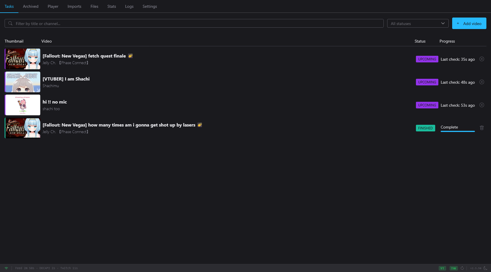
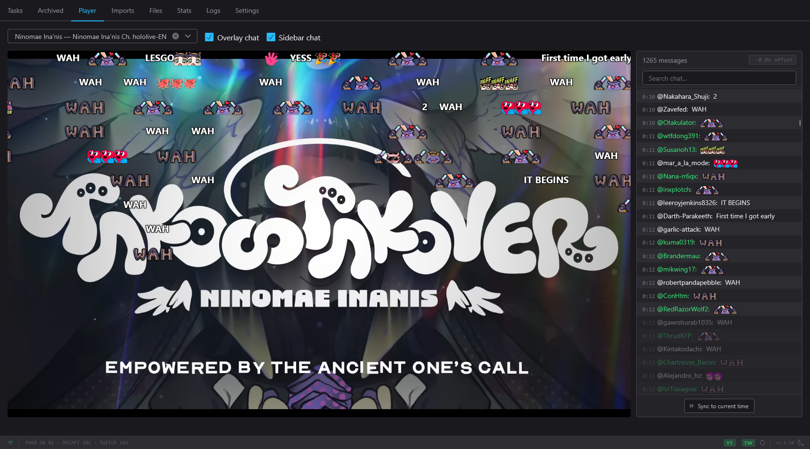
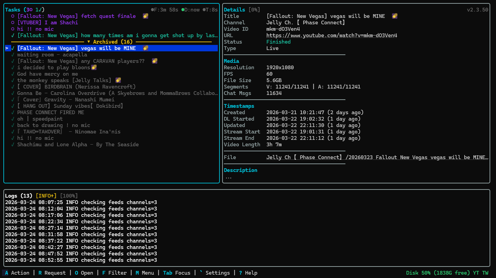

# Moombox

Moombox is a YouTube and Twitch live-stream archiver. You give it a list of
channels; it watches them, and when a stream is scheduled or goes live it
records the video and the live chat, muxes them into a finished file, and
keeps going on its own. It is a single program with a web dashboard and a
terminal UI, and the only thing it asks you to install is FFmpeg.

## What it does

-   **Watches your channels**

    ---

    YouTube channels are polled through their RSS feed, DecAPI and (signed
    in) their members-only tab; Twitch channels through Twitch's own API.
    Title filters, per-channel output folders and quality.

    → [Channels](guide/channels.md)

-   **Records live streams from the start**

    ---

    Live segments are fetched in parallel to catch up from the beginning of
    a YouTube stream, with chat, resume after a crash, and a new part when
    the stream's quality changes.

    → [Jobs](guide/jobs.md) ·
    [YouTube](guide/youtube.md) · [Twitch](guide/twitch.md)

-   **Archives the back catalogue too**

    ---

    Optionally archive uploads, finished premieres, past Twitch broadcasts
    and clips, paced a few at a time per channel so live streams never wait.

    → [Past content and backlog](guide/channels.md#past-content-backlog-and-archive-slots)

-   **Web dashboard**

    ---

    Live job list with filters, job details and logs, settings, imports,
    orphaned-file cleanup and statistics, in your browser. It listens on this
    machine only until you allow LAN or external access
    ([Network settings](configuration/network.md)).

    → [Web dashboard](guide/web-dashboard.md)

-   **Player with chat replay**

    ---

    Watch an archive in the browser with its chat replayed beside it or
    flying across the video, Niconico-style.

    → [Player](guide/player.md) ·
    [Chapters](guide/chapters.md)

-   **Terminal UI**

    ---

    A full-screen terminal interface with keyboard chords, mouse support,
    job details, logs and the same settings as the dashboard.

    → [Terminal UI](guide/terminal-ui.md) ·
    [Shortcuts](reference/shortcuts.md)

-   **Members-only and sign-in**

    ---

    Log in once in a browser Moombox opens for you; it keeps the cookies
    fresh and tells you when a login needs repairing.

    → [Cookies](guide/cookies.md)

-   **Notifications**

    ---

    Discord webhook messages for stream and system events, with per-target
    event filters and mentions.

    → [Notifications](guide/notifications.md)

-   **Looks after its own disk and updates**

    ---

    Disk-space alerts, staging cleanup, and signed self-updates you apply
    from either UI.

    → [Storage](guide/storage.md) ·
    [Updating](getting-started/updating.md)

-   **Works with yt-dlp**

    ---

    Moombox's PO-token endpoint and bundled plugin let yt-dlp use the same
    BotGuard solver.

    → [yt-dlp plugin](guide/ytdlp-plugin.md)

## Screenshots

=== "Web dashboard"

    

=== "Player with chat replay"

    

=== "Terminal UI"

    

## Supported platforms

| Platform | Download | Notes |
|---|---|---|
| Windows x64 | `Moombox.exe` | Full feature set, including reading cookies from your installed browsers and the FFmpeg installer. |
| Linux x64 | `moombox-linux-amd64` | Same dashboard, terminal UI and download pipeline as Windows. Windows-only conveniences say so in the UI. |
| Linux arm64 | `moombox-linux-arm64` | As Linux x64, with smaller default download buffers. |
| Docker (x64, arm64) | `ghcr.io/vampiricwulf/moombox` | FFmpeg is included in the image. |

Everything runs from one file: the dashboard, the terminal UI and the
BotGuard sidecar are built in. FFmpeg must be on your `PATH` (or set its path
in Settings) for anything except the Docker image.

## Quick start

1. **Install FFmpeg** and make sure `ffmpeg` runs from a terminal.
   ([Installation](getting-started/installation.md))
2. **Download and run Moombox** for your platform from the
   [latest release](https://github.com/vampiricwulf/Moombox/releases/latest).
   On Windows, double-click `Moombox.exe`; on Linux, `chmod +x` the binary
   and run it. Or use [Docker](getting-started/docker.md).
3. **Open the dashboard** at <http://localhost:774> (or use the terminal UI
   in the same window) and follow the first-run wizard.
   ([First run](getting-started/first-run.md))
4. **Add a channel** under **Settings → Channels**, by pasting its URL.
   Moombox starts watching it straight away.
   ([Channels](guide/channels.md))

!!! tip "Members-only streams"
    To archive members-only content, set up YouTube cookies during the
    wizard or later from **Settings → Cookies**. See
    [Cookies](guide/cookies.md).

## Where to go next

- New install: [Installation](getting-started/installation.md) →
  [First run](getting-started/first-run.md).
- Every setting, with its default and range:
  [Configuration](configuration/index.md).
- Something not working: [Troubleshooting](help/troubleshooting.md) and the
  [FAQ](help/faq.md).

## Credits

Moombox grew out of nosoop's [moombox](https://github.com/nosoop/moombox)
and [moonarchive](https://github.com/nosoop/moonarchive), and learned much of
what it knows from yt-dlp, BgUtils, ejs, chatterino7 and others. The full
list of projects, libraries and services it is built on is in the
[README on GitHub](https://github.com/vampiricwulf/Moombox#thanks).
